# Assignment 1 操作步骤

姓名：<填写>　学号：<填写>　GitHub 用户名：rainbow180121920

## 一、环境安装

使用 **Windows + WSL2 + Ubuntu 22.04**。本课程脚本会下载预编译 LLVM，一般预留 **10–15 GB** 可用空间即可；想留出更新、重复构建和测试文件的余量，可准备约 **15–20 GB**。无需下载桌面 ISO。此前写的 30–40 GB 只适合从源码编译 LLVM或长期保存多套构建文件，对本作业过于保守。

相关网址：

- WSL 安装说明：https://learn.microsoft.com/zh-cn/windows/wsl/install
- Ubuntu 22.04 官方镜像：https://releases.ubuntu.com/22.04/
- 课程 SVF：https://github.com/SA-BIT2026/SVF

### 第 1 步：安装 Ubuntu 22.04

开始菜单搜索 PowerShell → 右键 → **以管理员身份运行**，执行：

```powershell
wsl --install -d Ubuntu-22.04
```

按提示重启电脑，然后打开 Ubuntu：

```powershell
wsl -d Ubuntu-22.04
```

首次启动设置 Linux 用户名和密码。输入密码时不显示字符，属于正常情况。

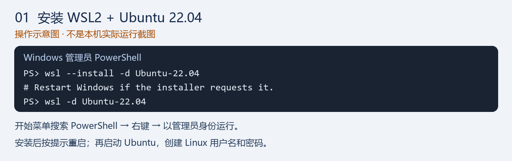

**实际安装界面：**

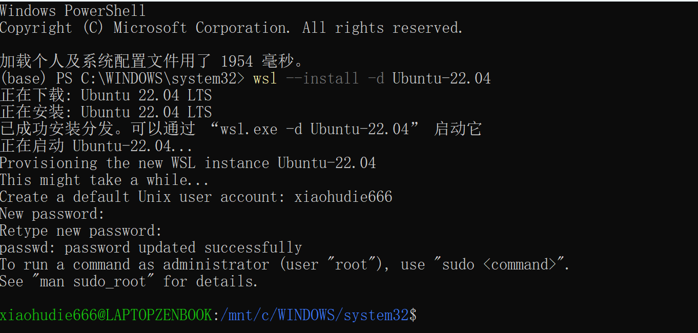

图中 `passwd: password updated successfully` 表示密码设置成功；末尾出现 `xiaohudie666@LAPTOPZENBOOK:...$`，说明已进入 Ubuntu。即使窗口标题仍是 Windows PowerShell，当前输入的命令也在 Ubuntu 中执行。

当前路径是 `/mnt/c/WINDOWS/system32`，对应 Windows 系统目录。先执行以下命令，回到 Linux 用户目录再继续：

```bash
cd ~
pwd
```

本截图对应的用户目录应为 `/home/xiaohudie666`。接下来按第 2 步检查版本，再进行第 3 步依赖安装。


### 第 2 步：检查版本

在 **Windows PowerShell** 中执行：

```powershell
wsl -l -v
```

确认 `Ubuntu-22.04` 的 `VERSION` 为 `2`。若为 `1`，执行：

```powershell
wsl --set-version Ubuntu-22.04 2
```

### Ubuntu 中的报错与解决方法

如果在 Ubuntu 提示符（例如 `xiaohudie666@LAPTOPZENBOOK:~$`）后输入 `wsl -l -v`，会出现：

```text
wsl: command not found
```

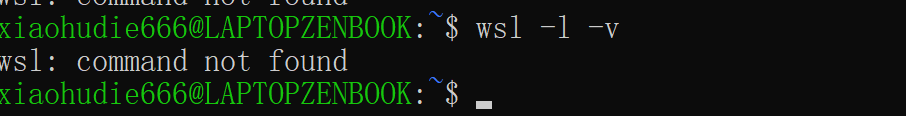

**原因：** `wsl` 是 Windows 命令，Ubuntu 中不能直接按这个名称调用。这不是 Ubuntu 安装失败。

**解决：** 不用退出 Ubuntu，在当前终端执行 Windows 可执行文件名：

```bash
wsl.exe -l -v
```

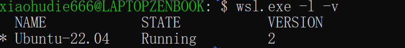

**成功标志：** 图中 `Ubuntu-22.04` 的 `STATE` 为 `Running`，`VERSION` 为 **2**，说明该发行版正在运行并使用 WSL2。下一步继续检查 Ubuntu 系统版本。

在 **Ubuntu 终端**执行：

```bash
cat /etc/os-release
```

确认包含 `VERSION_ID="22.04"`。下面的命令均在 Ubuntu 中执行。

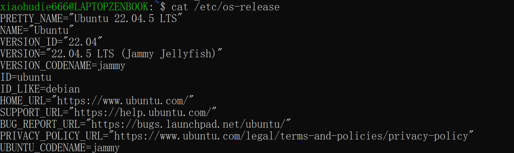

**操作描述：** 在 Ubuntu 终端执行 `cat /etc/os-release`，读取系统发行版信息，确认当前安装的 Ubuntu 版本。

| 输出字段 | 含义与检查结果 |
| --- | --- |
| `PRETTY_NAME="Ubuntu 22.04.5 LTS"` | 当前系统完整名称为 Ubuntu 22.04.5 LTS |
| `VERSION_ID="22.04"` | 属于 Ubuntu 22.04 系列，符合本指南的环境要求 |
| `VERSION="22.04.5 LTS (Jammy Jellyfish)"` | 22.04.5 是 22.04 系列的维护版本；LTS 表示长期支持版本 |
| `VERSION_CODENAME=jammy` | 系统版本代号为 jammy |

**检查结论：** Ubuntu **22.04.5 LTS** 已确认；结合上一张截图的 `VERSION=2`，当前环境为 **WSL2 + Ubuntu 22.04.5 LTS**，可以继续第 3 步安装依赖和 CMake。注意：WSL 的 `VERSION=2` 与 Ubuntu 的 `VERSION_ID="22.04"` 分别表示 WSL 版本和 Linux 系统版本。


### 第 3 步：安装依赖和 CMake

**分段执行：上一段成功后再执行下一段，报错时先停下。**

先更新软件源并安装依赖：

```bash
sudo apt update && sudo apt install -y git build-essential cmake libncurses5 libncurses-dev zlib1g-dev curl unzip xz-utils libz3-dev graphviz nano openssh-client python3-venv
```

安装成功后，再创建虚拟环境并安装 CMake。`&&` 表示上一条命令成功才执行下一条：

```bash
python3 -m venv ~/.venvs/sa-tools &&
source ~/.venvs/sa-tools/bin/activate &&
python -m pip install 'cmake>=3.23,<4' &&
cmake --version
```

确认 CMake 版本至少为 **3.23**。

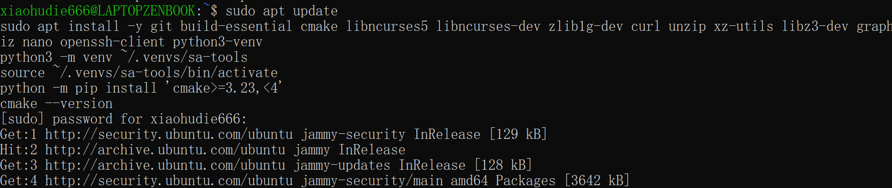

**截图描述：** 在 Ubuntu 终端输入依赖和 CMake 安装命令后，`sudo` 要求输入 Linux 用户密码。图中的 `Get:` 表示正在下载软件源索引，`Hit:` 表示对应索引无需重新下载；当前显示的是 `sudo apt update` 的执行过程。

**当前状态：** 软件源更新正在进行。截图尚未显示依赖安装完成或 `cmake --version` 的结果，因此不能据此确认 CMake 已安装成功。按上方分段命令操作，并检查最终 CMake 版本是否至少为 3.23；若出现错误，先解决后再继续第 4 步。


**虚拟环境创建失败的实际报错：**

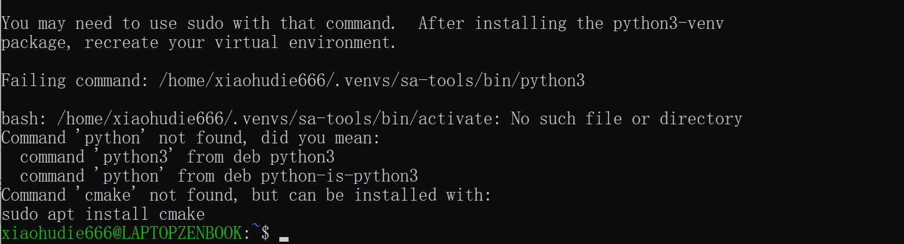

截图提示需要安装 `python3-venv` 并重新创建虚拟环境；`activate` 文件不存在说明环境创建没有完成。激活失败后，`python` 命令仍不可用，CMake 也没有成功安装。此前 apt 安装为什么失败，仅凭这张截图无法确定，应查看上方 apt 的错误信息。

先单独补装必要软件：

```bash
sudo apt install -y python3-venv cmake
```

确认成功后，重新执行上面的虚拟环境创建与 CMake 安装命令，可复用原来的目录，无需删除。如果 apt 仍报错，先查看 apt 的完整报错，不要继续后面的命令。[Python venv 说明](https://docs.python.org/3.10/library/venv.html)

**修复后的成功结果：**

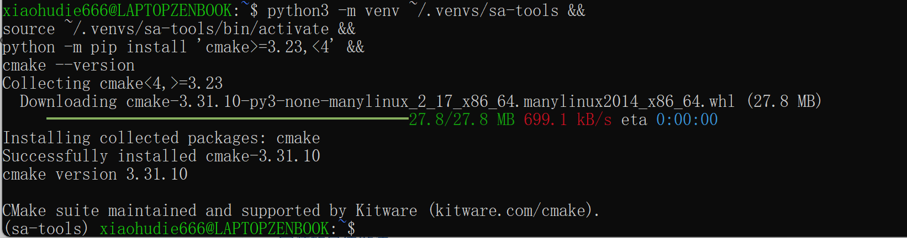

- `Successfully installed cmake-3.31.10`：CMake 安装成功。
- `cmake version 3.31.10`：版本高于作业要求的 3.23，满足 CMake 版本要求。
- 提示符前的 `(sa-tools)`：虚拟环境已创建并激活，之前的创建和激活报错已解决。

**检查结论：** 第 3 步中的虚拟环境和 CMake 配置已成功，可以继续第 4 步下载、编译 SVF。本截图确认的是这些工具配置，不代表 SVF 已编译或作业测试已完成。

### 第 4 步：下载并编译 SVF

```bash
mkdir -p ~/sa-course
cd ~/sa-course
git clone https://github.com/SA-BIT2026/SVF.git
cd SVF
bash ./build.sh
```

`build.sh` 会依次下载并解压 LLVM、下载并解压 Z3，然后使用 CMake 编译 SVF。整个过程需要一段时间；终端没有重新出现命令提示符以前，不要按 **Ctrl+C**，也不要关闭窗口。

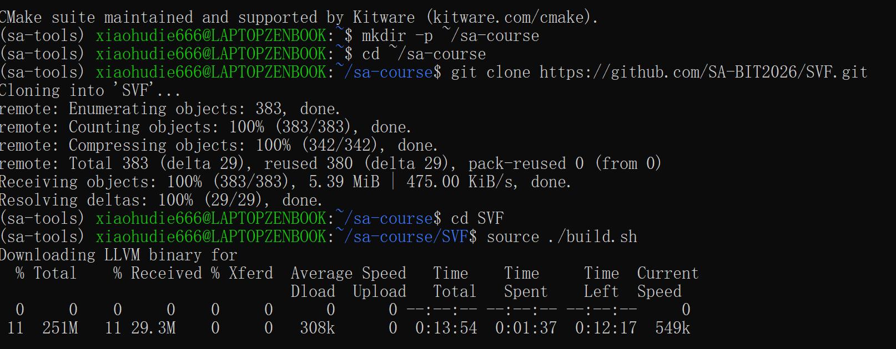

**截图说明：** `SVF` 仓库已经 Clone 成功，`Receiving objects` 和 `Resolving deltas` 均为 100%。随后构建脚本开始下载约 251 MiB 的 LLVM 预编译包，截图中进度约为 11%（29.3 MiB）。这是正常下载过程，不是报错，也不代表 SVF 已经编译完成。截图中执行的 `source ./build.sh` 已经启动本次构建，无需中断或重来；以后首次构建或失败后重试，使用上方更稳妥的 `bash ./build.sh`。

等待下载、解压和编译全部完成，直到终端重新出现提示符。然后载入环境并执行完整检查：

```bash
source ~/sa-course/SVF/setup.sh
echo "$SVF_DIR"
"$LLVM_DIR/bin/clang" --version
test -x "$SVF_DIR/Release-build/bin/wpa" && echo "SVF build OK"
```

成功时，`SVF_DIR` 应为 `/home/xiaohudie666/sa-course/SVF`，clang 应显示 LLVM 16，并且最后一行输出 `SVF build OK`。只有满足这三个条件，才能继续第 5 步。如果提示符提前返回并出现 `error`、`failed` 等信息，请保留终端末尾的完整报错截图，不要继续后面的步骤。

如果下载或编译中断，不要再次执行 `git clone`。进入已经存在的仓库后重试即可：

```bash
cd ~/sa-course/SVF
bash ./build.sh
```

#### 实际报错：缺少 unzip，并返回了 PowerShell

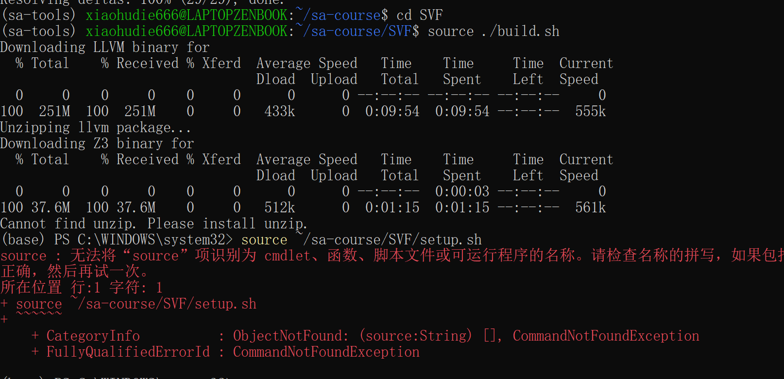

**截图说明：** LLVM 的 251 MiB 预编译包已经下载并完成解压，Z3 的 37.6 MiB 压缩包也已下载；随后出现 `Cannot find unzip. Please install unzip.`，说明 Ubuntu 中缺少 `unzip`，Z3 尚未解压，SVF 也尚未编译完成。第 3 步虽然列出了 `unzip`，但此前依赖安装没有完整成功，因此该软件实际上没有安装。

报错后提示符变为 `(base) PS C:\WINDOWS\system32>`，表示当前已经回到 **Windows PowerShell**。这是因为当时使用 `source ./build.sh` 启动了带有退出行为的构建脚本；PowerShell 不支持 Linux 的 `source`，所以随后输入 `source ~/sa-course/SVF/setup.sh` 又出现 `CommandNotFoundException`。这不是新的 Ubuntu 故障。

按下面顺序恢复。先在当前 **Windows PowerShell** 中重新进入 Ubuntu：

```powershell
wsl -d Ubuntu-22.04 -u xiaohudie666
```

看到 `xiaohudie666@LAPTOPZENBOOK` 的 Ubuntu 提示符后执行：

```bash
cd ~
source ~/.venvs/sa-tools/bin/activate
sudo apt update
sudo apt install -y unzip
unzip -v | head -n 1
cd ~/sa-course/SVF
bash ./build.sh
```

构建脚本会复用已经下载、解压的 LLVM 和已经下载的 `z3.zip`，通常无需重新下载这两份文件。继续等待脚本完成，重新出现 Ubuntu 提示符后，再执行第 4 步中的 `setup.sh`、clang 版本和 `SVF build OK` 检查。只有在后续明确出现 Z3 压缩包损坏提示时，才执行 `rm -f ~/sa-course/SVF/z3.zip` 后重新运行 `bash ./build.sh`。

#### 实际报错：链接器找不到 libstdc++

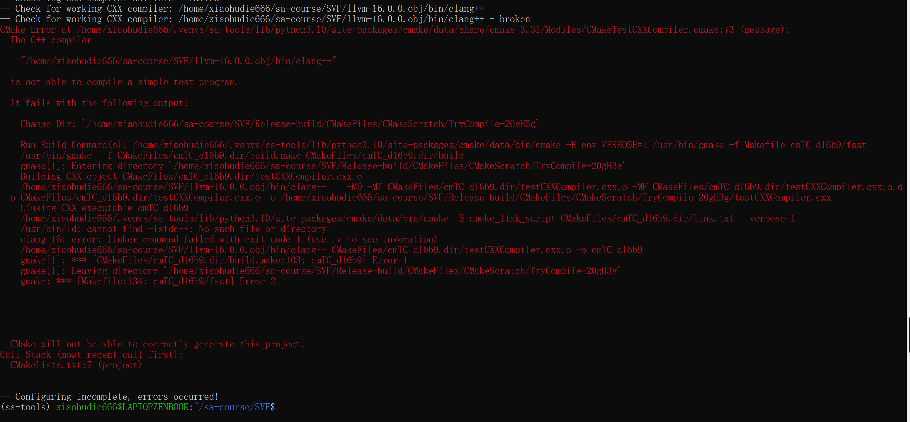

**截图说明：** 构建已经进入 CMake 配置阶段，下载的 `clang++` 能正常启动，但测试程序在链接时出现 `/usr/bin/ld: cannot find -lstdc++`。这表示 Ubuntu 没有安装 C++ 标准库的开发链接文件；不是 LLVM 或 Z3 损坏。实际检查确认当前系统缺少 `build-essential`、`g++` 和 `libstdc++-11-dev`，说明第 3 步的整组依赖此前没有完整安装。

当前提示符仍是 Ubuntu 中的 `(sa-tools) xiaohudie666@LAPTOPZENBOOK:~/sa-course/SVF$`，可直接执行：

```bash
sudo apt update
sudo apt install -y build-essential g++ libstdc++-11-dev
g++ --version
ls -l /usr/lib/x86_64-linux-gnu/libstdc++.so
```

然后用课程 LLVM 的 `clang++` 编译一个最小程序，确认链接器已经修复：

```bash
printf 'int main(){return 0;}\n' > /tmp/cxx-test.cpp
~/sa-course/SVF/llvm-16.0.0.obj/bin/clang++ /tmp/cxx-test.cpp -o /tmp/cxx-test &&
/tmp/cxx-test &&
echo "C++ linker OK"
```

看到 `C++ linker OK` 后重新构建：

```bash
cd ~/sa-course/SVF
bash ./build.sh
```

`build.sh` 会自动删除本次失败留下的 `Release-build` 并重新配置；已经下载的 LLVM 和 Z3 会继续复用，无需手动删除或重新 Clone。构建完成后，再执行第 4 步中的 `setup.sh`、LLVM 版本和 `SVF build OK` 检查。

#### 实际成功：SVF 编译完成

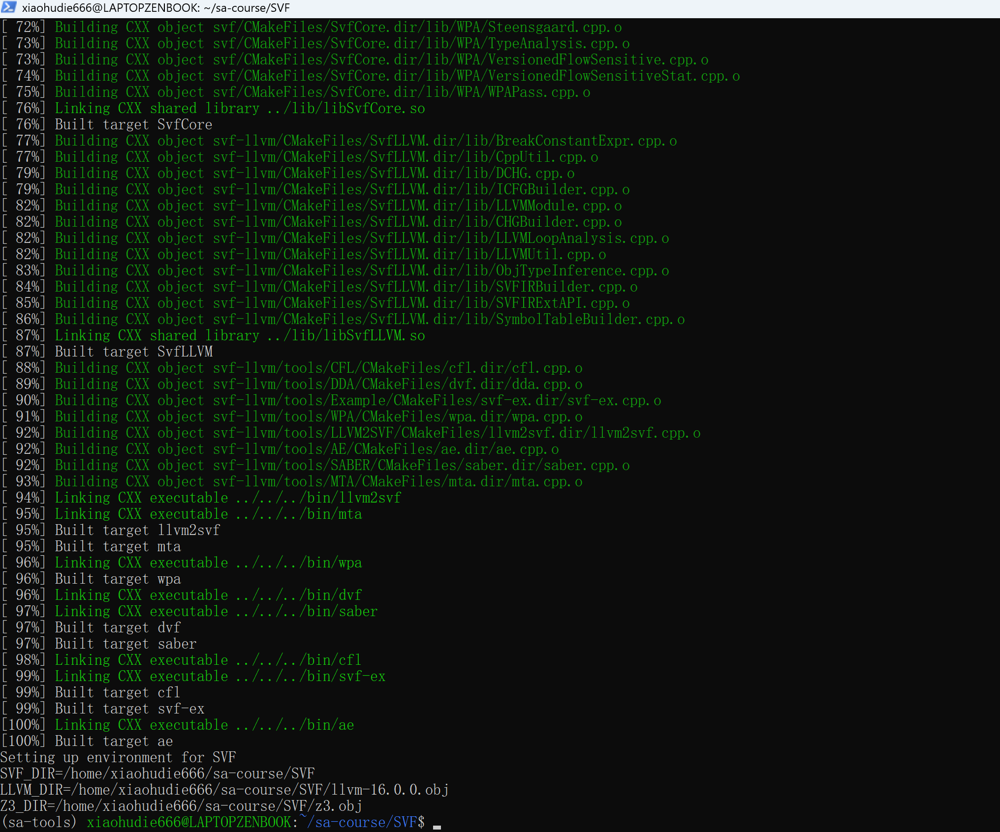

**截图说明：** 编译进度到达 100%，`SvfCore`、`SvfLLVM`、`wpa`、`ae` 等目标均显示 `Built target`，随后输出 `Setting up environment for SVF` 以及 `SVF_DIR`、`LLVM_DIR`、`Z3_DIR`，最后正常返回 Ubuntu 提示符，说明 SVF 已成功编译。

进一步检查已确认：LLVM 版本为 **16.0.4**，`/home/xiaohudie666/sa-course/SVF/Release-build/bin/wpa` 存在并具有执行权限。第 4 步已经完成，可以继续第 5 步 Fork 并 Clone 作业仓库。由于本次使用 `bash ./build.sh`，新终端或当前父终端仍应执行一次 `source ~/sa-course/SVF/setup.sh`，再运行后续作业命令。

## 二、下载作业

作业网址：https://github.com/SA-BIT2026/Assignment-1

### 第 5 步：Fork 并 Clone

1. 登录 GitHub，打开上述作业网址。
2. 点击 **Fork → Create fork**，复制到自己的账号。
3. 本次使用的 GitHub 用户名为 `rainbow180121920`，执行：

```bash
cd ~/sa-course
git clone https://github.com/rainbow180121920/Assignment-1.git
cd Assignment-1
git remote -v
```

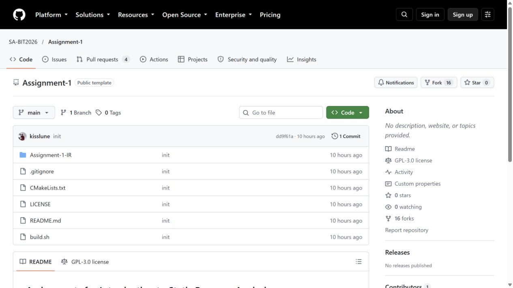

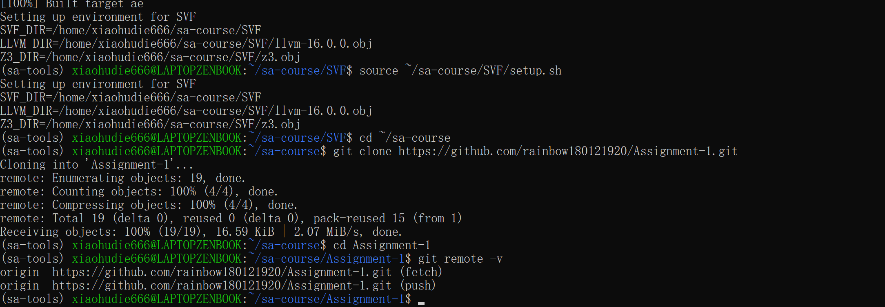

**截图说明：** 执行 `source ~/sa-course/SVF/setup.sh` 后，`SVF_DIR`、`LLVM_DIR` 和 `Z3_DIR` 均正确。随后从 `rainbow180121920/Assignment-1` 接收 19/19 个对象并进入仓库，`git remote -v` 显示 `origin` 的 fetch 和 push 地址都指向自己的 Fork，说明 Fork 与 Clone 已完成。无需重新 Clone，也不必修改 `origin`。

## 三、修改代码

### 第 6 步：补全 TODO

```bash
nano Assignment-1-IR/SVFIR.cpp
```

找到 TODO，在 `//@{` 与 `//@}` 之间加入：

```cpp
SVFIR* pag = builder.build();
pag->dump("pag");
pag->getCallGraph()->dump("callgraph");
pag->getICFG()->dump("icfg");
```

按 **Ctrl+O → Enter** 保存，**Ctrl+X** 退出。

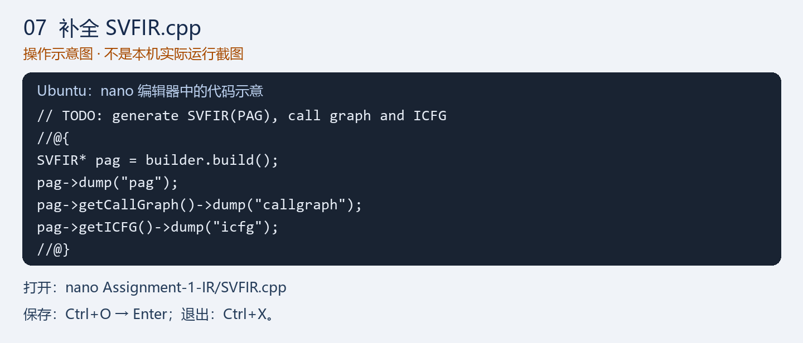

**当前实际状态：** 已检查本机 `Assignment-1-IR/SVFIR.cpp`，上述四行代码已经正确保存在 `//@{` 与 `//@}` 之间。可用下面的命令复核改动，然后继续第 7 步编译：

```bash
git diff -- Assignment-1-IR/SVFIR.cpp
```

## 四、编译和测试

### 第 7 步：编译作业

```bash
source ~/.venvs/sa-tools/bin/activate
source ~/sa-course/SVF/setup.sh
cd ~/sa-course/Assignment-1
bash ./build.sh &&
test -x Assignment-1-IR/svfir &&
echo "Assignment build OK"
```

看到 `Assignment build OK`，说明编译成功并生成了 `Assignment-1-IR/svfir`。

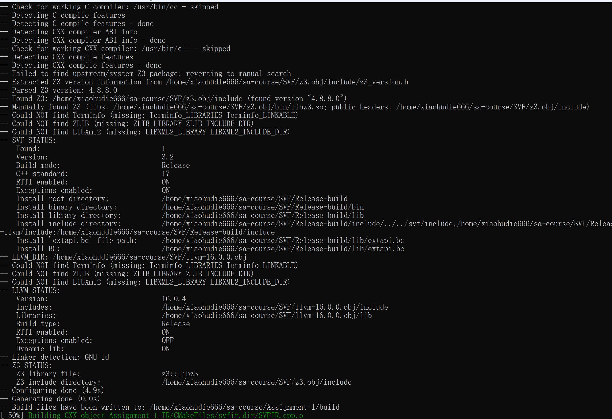

**截图说明：** CMake 已找到 SVF 3.2、LLVM 16.0.4 和 Z3 4.8.8，并成功生成构建文件；画面底部正在编译 `SVFIR.cpp`，进度为 50%。`Could NOT find Terminfo`、`ZLIB`、`LibXml2` 是本次构建未使用的可选组件提示，没有阻止后续生成 `svfir`。

### 第 8 步：运行测试并查看图

```bash
cd Assignment-1-IR
mkdir -p /tmp/sa-assignment1
rm -f pag.dot callgraph.dot icfg.dot
"$LLVM_DIR/bin/clang" -O0 -g -emit-llvm -c Test-Cases/add.c -o /tmp/sa-assignment1/add.bc &&
./svfir /tmp/sa-assignment1/add.bc &&
test -s pag.dot &&
test -s callgraph.dot &&
test -s icfg.dot &&
echo "Test passed: three DOT files were generated"
```

看到 `Test passed: three DOT files were generated`，说明本次运行确实生成了三个非空 DOT 文件。测试前先删除旧文件，可以避免把上一次的结果误认为本次成功。然后转成图片：

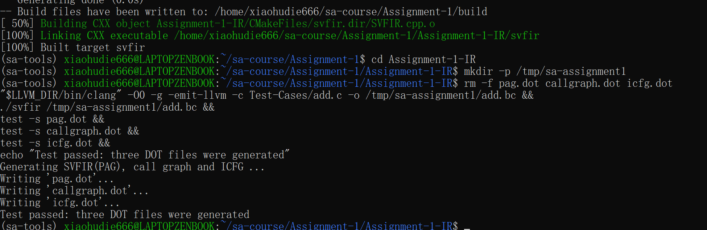

**实际结果：** `svfir` 已构建到 100%，运行 `add.bc` 后依次显示 `Writing 'pag.dot'`、`Writing 'callgraph.dot'`、`Writing 'icfg.dot'`，最后输出 `Test passed: three DOT files were generated`。本机进一步检查确认三个 DOT 文件均存在且非空，因此作业核心功能测试已经通过。

如果执行 `dot` 时出现 `Command 'dot' not found`，只是 Graphviz 尚未安装，不影响上述 DOT 文件测试。先安装并检查：

```bash
sudo apt update
sudo apt install -y graphviz
dot -V
```

然后回到 DOT 文件所在目录并转成图片：

```bash
cd ~/sa-course/Assignment-1/Assignment-1-IR
mkdir -p /tmp/sa-assignment1
dot -Tpng pag.dot -o /tmp/sa-assignment1/pag.png
dot -Tpng callgraph.dot -o /tmp/sa-assignment1/callgraph.png
dot -Tpng icfg.dot -o /tmp/sa-assignment1/icfg.png
cd /tmp/sa-assignment1
explorer.exe .
```

双击 PNG 查看图。再对 `Test-Cases` 中其他 C 文件重复测试：替换输入文件名和输出 bitcode 名称即可。每次运行生成的同名 DOT 图会覆盖上一次结果，需要留存时先另行保存。

## 五、提交作业

### 第 9 步：设置 Git 身份和认证

本次 Git 身份配置为：

```bash
cd ~/sa-course/Assignment-1
git config user.name rainbow180121920
git config user.email 1909815939@qq.com
git config --get-regexp '^user\.'
```

确认输出的用户名和邮箱没有多余引号。已有可用 GitHub 推送认证则跳过以下配置。没有 SSH 密钥时，先单独执行：

```bash
ssh-keygen -t ed25519 -C "1909815939@qq.com"
```

出现 `Enter file in which to save the key (/home/xiaohudie666/.ssh/id_ed25519):` 时，直接按 **Enter** 接受默认路径。随后出现两次 passphrase 提示；为了操作简单，可以连续按 **Enter 两次**留空。不要在这个交互提示后粘贴其他命令。

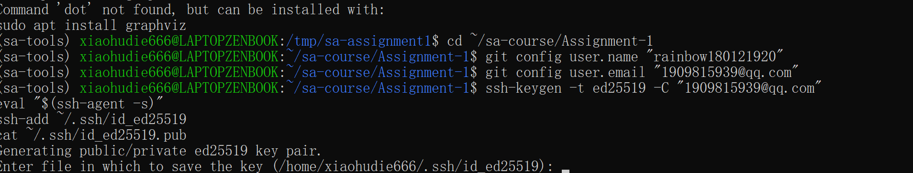

**截图说明：** 这不是卡死，`ssh-keygen` 正在等待键盘输入。截图上方的 `dot not found` 是尚未安装 Graphviz，与生成 SSH 密钥无关。密钥生成并重新出现普通 `$` 提示符后，再逐行执行：

```bash
eval "$(ssh-agent -s)"
ssh-add ~/.ssh/id_ed25519
cat ~/.ssh/id_ed25519.pub
```

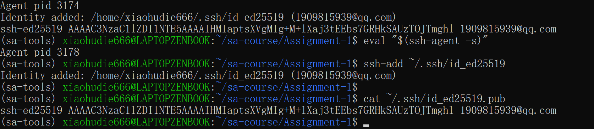

**截图说明：** `Identity added` 表示私钥已成功载入 SSH agent；随后 `cat ~/.ssh/id_ed25519.pub` 输出了以 `ssh-ed25519` 开头的完整公钥。该公钥已添加到 GitHub，并已验证 GitHub 能将其识别为账号 `rainbow180121920`。

复制 `cat` 输出中以 `ssh-ed25519` 开头的完整一行，将 **.pub 公钥**添加到 GitHub：头像 → **Settings → SSH and GPG keys → New SSH key**。只能复制或公开 `id_ed25519.pub`，不要复制私钥 `id_ed25519`。

配置说明：https://docs.github.com/en/authentication/connecting-to-github-with-ssh/adding-a-new-ssh-key-to-your-github-account

直接测试默认 SSH 地址时，本机网络关闭了 22 端口：

```bash
ssh -T git@github.com
```

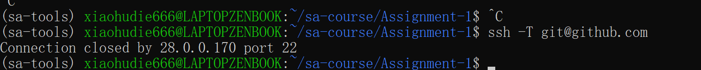

`Connection closed ... port 22` 表示网络连接问题，不是密钥错误。GitHub 官方还提供 443 端口；本机已实际验证下面的 443 入口能够成功认证，并返回 `Hi rainbow180121920! You've successfully authenticated`：

```bash
ssh -T -p 443 git@ssh.github.com
```

由于本机尚无 `~/.ssh/config`，执行下面的完整命令，让以后访问 `github.com` 时自动走 443 端口：

```bash
cat > ~/.ssh/config <<'EOF'
Host github.com
    HostName ssh.github.com
    User git
    Port 443
    IdentityFile ~/.ssh/id_ed25519
    IdentitiesOnly yes
EOF
chmod 600 ~/.ssh/config
ssh -T git@github.com
```

首次询问是否信任主机时，应对照 [GitHub 官方指纹](https://docs.github.com/en/authentication/keeping-your-account-and-data-secure/githubs-ssh-key-fingerprints)，一致后输入 `yes`。看到包含 `rainbow180121920` 的认证成功消息即可；GitHub 不提供 SSH shell，所以该提示之后退出属于正常情况。然后把作业仓库改为 SSH 地址：

```bash
cd ~/sa-course/Assignment-1
git remote set-url origin git@github.com:rainbow180121920/Assignment-1.git
git remote -v
```

### 第 10 步：填写 README 并推送

1. 将本指南的 **README.md 和 images 文件夹**一起复制进作业仓库根目录。在你这台电脑的 Ubuntu 终端中执行：

```bash
cd ~/sa-course/Assignment-1
cp /mnt/c/Users/19098/Documents/Codex/2026-10-10/f/outputs/README.md ./README.md
mkdir -p images
cp -r /mnt/c/Users/19098/Documents/Codex/2026-10-10/f/outputs/images/. ./images/
```

2. 填写 README 开头的姓名、学号、GitHub 用户名和末尾的实际测试记录。
3. 执行：

```bash
cd ~/sa-course/Assignment-1
git status --short
git add Assignment-1-IR/SVFIR.cpp README.md images/
git diff --cached --stat
git commit -m "Complete Assignment 1"
git push origin main
```

刷新自己的 GitHub 仓库，确认代码和 README 已更新。不要提交 LLVM、Z3、构建目录或临时测试文件。

### 第 11 步：创建 Pull Request

自己的 Fork 页面 → **Contribute → Open pull request**。

确认提交方向：

- **Base**：`SA-BIT2026/Assignment-1` 的 `main`。
- **Head**：自己 Fork 的 `main`。

填写标题，例如 `Assignment 1 - 姓名 - 学号`，说明实际测试结果，检查改动后点击 **Create pull request**，记录 PR 链接。

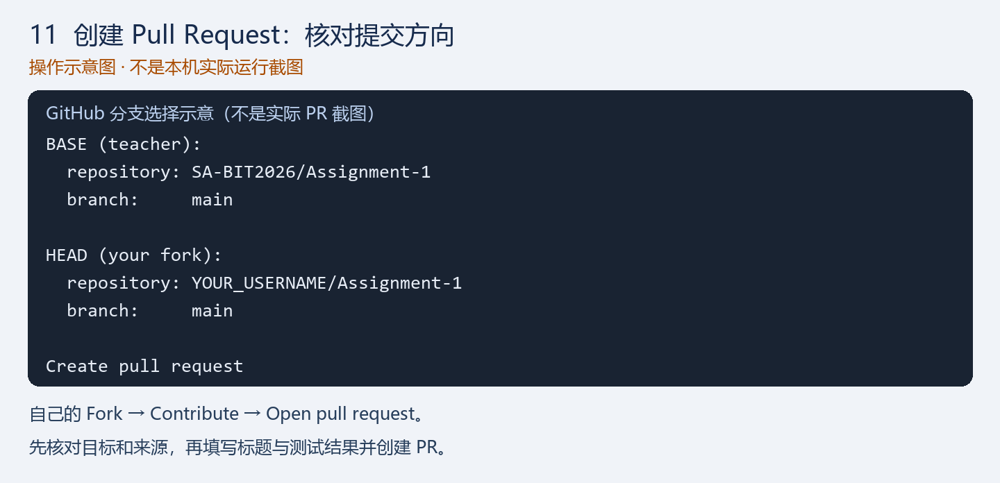

## 六、下次启动

Windows PowerShell（明确以 `xiaohudie666` 登录）：

```powershell
wsl -d Ubuntu-22.04 -u xiaohudie666
```

如果启动后当前位置是 `/mnt/c/WINDOWS/system32`，先回到 Linux 用户主目录并恢复 CMake 环境：

```bash
cd ~
source ~/.venvs/sa-tools/bin/activate
cmake --version
```

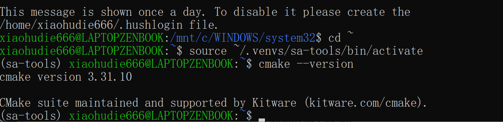

**截图说明：**

- 提示符中的 `xiaohudie666@LAPTOPZENBOOK` 表示已使用正确的 Linux 用户进入 Ubuntu。
- `cd ~` 将目录从 Windows 的 `/mnt/c/WINDOWS/system32` 切换到 `/home/xiaohudie666`。
- 提示符前出现 `(sa-tools)`，表示 Python 虚拟环境已恢复。
- `cmake version 3.31.10` 表示重启后 CMake 仍可正常使用，并满足作业要求。
- 开头的 `This message is shown once a day` 只是 Ubuntu 的每日提示，不是报错，无需处理。

**当前下一步：** SSH 密钥已经生成并添加到 GitHub，443 端口认证已实际成功；默认 22 端口被当前网络关闭。现在按第 9 步创建 `~/.ssh/config`，让 `github.com` 自动走 443，再将 `origin` 改为 SSH 地址。另需安装 Graphviz 后将三个 DOT 文件转成 PNG。以后每次启动，在继续作业前执行：

```bash
source ~/sa-course/SVF/setup.sh
cd ~/sa-course/Assignment-1
```

## 实际测试记录

- Ubuntu / WSL 版本：Ubuntu 22.04.5 LTS + WSL2（已通过实际截图确认）
- CMake / LLVM 版本：CMake 3.31.10；LLVM 16.0.4（均已实际检查）
- 编译结果：SVF Release 构建成功；Assignment-1 的 `svfir` 已构建到 100%
- 测试用例及结果：`Test-Cases/add.c` 已使用 LLVM 16 编译为 bitcode，运行后成功生成非空的 `pag.dot`、`callgraph.dot`、`icfg.dot`；Graphviz PNG 转换待完成
- GitHub 认证：ED25519 公钥已添加；SSH 22 端口被网络关闭，GitHub SSH 443 端口已成功认证；SSH config 与 origin 地址待更新
- PR 链接：<填写>

说明：本文包含 18 张用户提供的实机截图（安装、环境检查与恢复、依赖安装及两次修复、SVF 下载与编译、作业 Fork 与 Clone、Assignment-1 编译与测试、SSH 密钥生成及端口 22 报错）、1 张真实 GitHub 页面截图和 3 张标注的操作示意图。SVF 与 Assignment-1 均已在本机成功编译，`add.c` 的三个 DOT 图已通过实际测试，GitHub SSH 443 认证也已成功；Graphviz 转图、GitHub 推送和 PR 尚待完成。Ubuntu 官方 WSL 镜像标注约 **344M**；安装渠道及额外组件大小可能不同。
